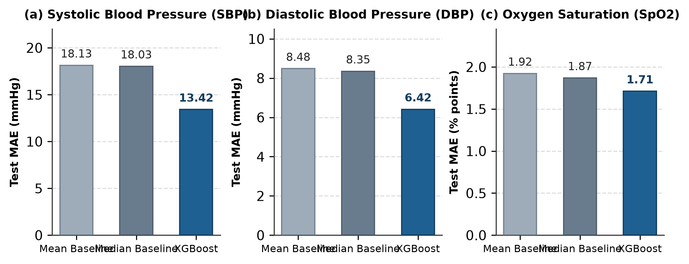
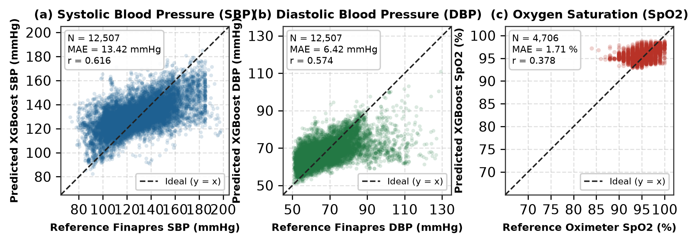
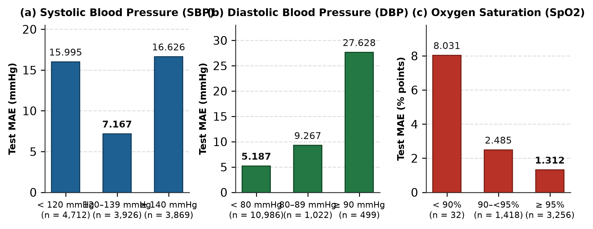
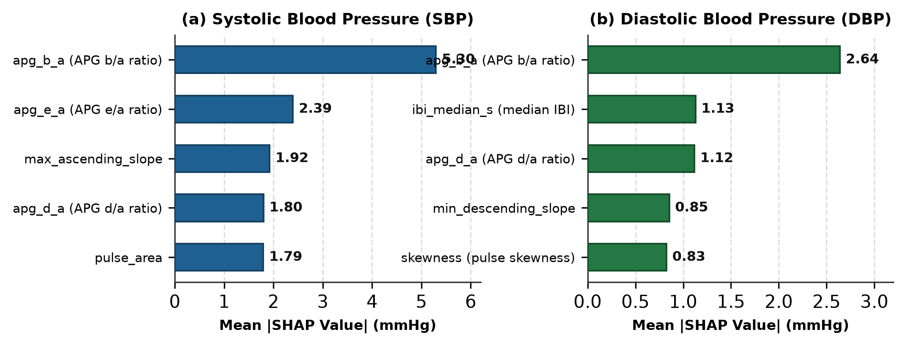
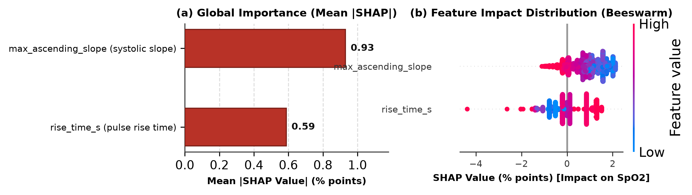

<div align="center">
  
  
  
  
  
  
</div>

<h1 align="center">PulseBoost</h1>

<p align="center">
  <strong>Cuffless Blood Pressure and Oxygen Saturation Estimation from Photoplethysmogram (PPG) Signals Using Gradient Tree Boosting.</strong>
</p>

<p align="center">
  An end-to-end computational framework combining digital signal processing, second-derivative PPG (APG) morphological feature engineering, Correlation-based Feature Selection (CFS), leakage-free cohort partitioning, and post-hoc TreeSHAP interpretability.
</p>

<p align="center">
  <em>Developed as part of the Scientific Research Methodology (KTI) curriculum at Universitas Padjadjaran (UNPAD).</em>
</p>

<hr />

## Overview

PulseBoost investigates the feasibility and physical boundaries of estimating continuous hemodynamic parameters—Systolic Blood Pressure (**SBP**), Diastolic Blood Pressure (**DBP**), and Peripheral Blood Oxygen Saturation (**SpO2**)—solely from fingertip Photoplethysmogram (PPG) waveforms without requiring an inflatable cuff.

The project addresses two distinct clinical learning tasks:
1. **Continuous Arterial Blood Pressure Estimation (SBP & DBP):** Derived from finger PPG records and continuous Finapres volume-clamp reference signals across 9,624 eligible recordings from the benchmark UCI Cuff-Less Blood Pressure dataset ($125\text{ Hz}$).
2. **Peripheral Oxygen Saturation Estimation (SpO2):** Derived from single-wavelength finger PPG and aligned nocturnal polysomnography (PSG) pulse oximetry reference signals across 30 verified obstructive sleep apnea patients from the OSASUD cohort ($80\text{ Hz}$).

To ensure scientific integrity, the framework enforces strict zero-leakage data partitioning, preserves raw amplitude scales without artificial 1D normalizations, selects optimal feature subsets via Correlation-based Feature Selection (CFS), evaluates models on sealed, single-pass test cohorts, and unpacks decision mechanisms using TreeSHAP.

---

## Key Features

- **Dual-Dataset Hemodynamic Pipeline:** Processes two independent physiological datasets—the large-scale UCI ICU continuous blood pressure corpus and the clinical OSASUD full-night sleep apnea cohort.
- **Zero-Phase Digital Signal Processing:** Implements a 4th-order Chebyshev Type II bandpass filter ($0.5 - 8.0\text{ Hz}$, $r_s = 20\text{ dB}$, effective $-3\text{ dB}$ passband $0.63 - 6.45\text{ Hz}$) via Second-Order Sections (SOS) forward-backward filtering (`sosfiltfilt`), eliminating phase distortion while preserving dicrotic notch timing.
- **Amplitude Scale Preservation:** Intentionally omits per-window 1D z-score normalization on continuous time series, retaining critical pulse amplitude and area variations that reflect microvascular perfusion.
- **Comprehensive APG Feature Engineering:** Extracts 19 candidate features comprising 15 morphological, temporal, amplitude, and frequency metrics alongside 4 second-derivative Acceleration Plethysmogram ratios ($b/a$, $c/a$, $d/a$, $e/a$) computed via Savitzky-Golay filtering.
- **Correlation-based Feature Selection (CFS):** Employs Hall's heuristic merit on training folds to eliminate collinear redundancies, isolating a compact 2-feature subset for SpO2 (`max_ascending_slope` and `rise_time_s`) to suppress nocturnal overfitting.
- **Leakage-Proof Partitioning Schemes:**
  - *UCI:* Record-wise grouping with complete isolation of 9,611 identical duplicate meta-groups into single partitions (70% Train, 15% Validation, 15% Test).
  - *OSASUD:* Subject-independent patient-level holdout (21 Train, 4 Validation, 5 Test: Patients 7, 8, 11, 15, and 20).
- **TreeSHAP Explainability:** Provides mathematically additive local and global attribution values ($\phi$) confirming that arterial compliance and ejection dynamics (`apg_b_a`) dominate blood pressure regression, whereas pulse slope and rise kinetics govern oxygen saturation estimates.
- **Strict Single-Pass Test Protocol:** Evaluates frozen models exactly once on unseen test sets without post-hoc tuning, retraining, or cherry-picking.

---

## Methodological Architecture

```
[Raw Finger PPG & Ground Truth ABP / SpO2]
                     │
                     ▼
  [30-Second Non-Overlapping Window Segmentation]
  (Rejects records < 30 s: TOO_SHORT)
                     │
                     ▼
  [Chebyshev Type II Order-4 Zero-Phase Bandpass (SOS)]
  (Wn = [0.5, 8.0] Hz, rs = 20 dB | Effective 0.63 - 6.45 Hz)
                     │
                     ▼
  [Fiducial Beat Detection & Physiological Quality Screening]
  (Requires >= 10 valid cardiac beats within 20 - 200 BPM)
                     │
                     ▼
  [Extraction of 19 Morphological & APG Features]
  (Savitzky-Golay 2nd derivative: a, b, c, d, e wave ratios)
                     │
                     ▼
  [Anti-Leakage Data Partitioning]
  ├─ UCI: Record-Wise Grouping + Duplicate Meta-Group Isolation
  └─ OSASUD: Patient-Wise Grouping (21 Train / 4 Val / 5 Test)
                     │
                     ▼
  [Feature Selection on TRAIN Split Only]
  ├─ BP Models: Config C (All 19 Features)
  └─ SpO2 Model: Config D (CFS Merit Selection -> 2 Features)
                     │
                     ▼
  [Gradient Boosted Decision Trees (XGBoost Regressor)]
  (Histogram splits, max_depth=4, early stopping=50 rounds)
                     │
                     ▼
  [Single-Pass Final Test Evaluation & TreeSHAP Interpretation]
```

---

## Feature Engineering Reference

The pipeline extracts 19 numerical features per 30-second window across time, amplitude, derivative, statistical, and spectral domains:

| Category | Feature Name | Unit | Physiological & Hemodynamic Significance |
| :--- | :--- | :---: | :--- |
| **Cardiac Timing** | `ibi_median_s` | s | Median inter-beat interval; governs diastolic filling duration and run-off pressure. |
| | `heart_rate_bpm` | bpm | Heart rate calculated directly from pulse intervals ($60 / \text{IBI}$). |
| | `ibi_cv` | - | Coefficient of variation of pulse intervals; reflects short-term autonomic heart rate variability. |
| | `rise_time_s` | s | Crest time from pulse foot to systolic peak; correlates with ventricular contractility and arterial stiffness. |
| | `decay_time_s` | s | Diastolic decay time from peak to subsequent foot; reflects peripheral resistance and vascular drainage. |
| | `pulse_width_50_s` | s | Pulse width at 50% systolic amplitude; measures pulse wave propagation broadening. |
| **Pulse Amplitude** | `pulse_amplitude` | ADC units | Peak-to-foot pulse amplitude; proportional to stroke volume and local microvascular compliance. |
| | `pulse_area` | units $\cdot$ s | Integrated total area under the pulse wave; correlates with stroke volume and vascular bed distensibility. |
| **Wave Dynamics** | `max_ascending_slope` | units/s | Maximum positive first-derivative during systolic upstroke; mirrors peak ventricular ejection acceleration. |
| | `min_descending_slope` | units/s | Minimum negative first-derivative during diastolic decay; reflects peripheral runoff impedance. |
| **Distribution** | `skewness` | - | Third standardized moment of windowed amplitude; captures baseline asymmetry and dicrotic positioning. |
| | `kurtosis` | - | Fourth standardized moment; quantifies peak sharpness vs. signal baseline spread. |
| **Spectral Domain** | `dominant_frequency_hz`| Hz | Primary peak frequency in the hemodynamic band ($0.5 - 3.0\text{ Hz}$) via Welch Periodogram. |
| | `spectral_power_ratio` | - | Power ratio of primary cardiac band ($0.5 - 3.0\text{ Hz}$) to broad filtered band ($0.5 - 8.0\text{ Hz}$). |
| | `spectral_entropy` | - | Shannon entropy of power spectral distribution; quantifies rhythmic irregularity and noise complexity. |
| **APG 2nd Derivative** | `apg_b_a` | - | Ratio of early systolic deceleration wave $b$ to acceleration wave $a$; index of large artery stiffness. |
| | `apg_c_a` | - | Ratio of late systolic re-acceleration wave $c$ to wave $a$; reflects systemic vascular resistance. |
| | `apg_d_a` | - | Ratio of early diastolic dicrotic notch wave $d$ to wave $a$; index of peripheral wave reflection intensity. |
| | `apg_e_a` | - | Ratio of late diastolic wave $e$ to wave $a$; reflects early ventricular relaxation and filling elasticity. |

> **Excluded Parameters:** The *Arterial Stiffness Index* ($SI = h / \Delta T_{\text{DVP}}$) was explicitly omitted because neither public dataset provides subject height ($h$). OSASUD's *Perfusion Index* (PI) channel was excluded from predictor matrices to prevent synthetic target leakage.

---

## Experimental Datasets & Splitting Protocol

### 1. UCI Cuff-Less Blood Pressure Estimation Dataset
- **Source:** Intensive Care Unit (ICU) continuous monitor records from PhysioNet / Kaggle.
- **Signals:** Fingertip PPG ($125\text{ Hz}$) paired with continuous Arterial Blood Pressure (ABP) via volume-clamp Finapres.
- **Raw Volume:** 12,000 signal records across 4 parts. Records under 30 seconds (2,376 records) were discarded (`TOO_SHORT`), yielding **9,624 eligible records** and **83,423 valid 30-second windows**.
- **Partitioning:** Grouped by record and duplicate meta-groups (9,611 identical duplicate groups isolated into identical splits) using `random_state=42`:
  - **Train:** 6,730 records / 58,396 windows (70.0%)
  - **Validation:** 1,459 records / 12,513 windows (15.0%)
  - **Test (Sealed):** 1,435 records / 12,507 valid labeled windows (15.0%)

### 2. OSASUD Sleep Apnea Dataset
- **Source:** Verified nocturnal polysomnography (PSG) recordings of 30 obstructive sleep apnea patients.
- **Signals:** Single-wavelength finger transmission PPG ($80\text{ Hz}$) aligned with continuous PSG finger pulse oximeter reference SpO2 ($80\text{ Hz}$).
- **Eligible Volume:** All 30 patients processed into **27,455 valid 30-second windows** ($100\%$ physiological retention).
- **Partitioning:** Strictly subject-independent patient holdout using `random_state=42`:
  - **Train:** 21 patients / 18,890 windows (68.80%)
  - **Validation:** 4 patients (IDs 19, 21, 27, 30) / 3,859 windows (14.06%)
  - **Test (Sealed):** 5 patients (IDs 7, 8, 11, 15, 20) / 4,706 windows (17.14%)

---

## Benchmark Results & Evaluation

All test metrics were computed in a single evaluation run on the sealed test partitions. Baseline comparisons are derived strictly from the full-precision central tendency of the training folds.

### Final Test Performance vs. Training Baselines

| Target Parameter | Evaluated Model / Baseline | $N_{\text{test}}$ | MAE | RMSE | Mean Error (ME) | STD(ME) | Pearson $r$ | $R^2$ | Improvement vs. Median |
| :--- | :--- | :---: | :---: | :---: | :---: | :---: | :---: | :---: | :---: |
| **Systolic BP (SBP)** | **XGBoost (Config C, 19 feats)** | **12,507** | **13.4191 mmHg** | **17.4862 mmHg** | **+1.4902** | **17.4232** | **0.6161** | **0.3739** | **+25.56%** |
| | Baseline Median TRAIN (128.51 mmHg) | 12,507 | 18.0279 mmHg | 22.1080 mmHg | -0.6461 | 22.0994 | *N/A* | -0.0009 | 0.00% |
| | Baseline Mean TRAIN (130.28 mmHg) | 12,507 | 18.1315 mmHg | 22.1273 mmHg | +1.1267 | 22.0994 | *N/A* | -0.0026 | -0.57% |
| **Diastolic BP (DBP)** | **XGBoost (Config C, 19 feats)** | **12,507** | **6.4159 mmHg** | **9.1516 mmHg** | **-0.0169** | **9.1519** | **0.5742** | **0.3287** | **+23.17%** |
| | Baseline Median TRAIN (64.71 mmHg) | 12,507 | 8.3505 mmHg | 11.4294 mmHg | -2.4236 | 11.1699 | *N/A* | -0.0471 | 0.00% |
| | Baseline Mean TRAIN (66.87 mmHg) | 12,507 | 8.4828 mmHg | 11.1725 mmHg | -0.2621 | 11.1699 | *N/A* | -0.0006 | -1.59% |
| **Oxygen Saturation ($SpO_2$)** | **XGBoost (Config D, 2 CFS feats)** | **4,706** | **1.7114 %** | **2.2018 %** | **+0.2146** | **2.1916** | **0.3781** | **0.1280** | **+8.42%** |
| | Baseline Median TRAIN (96.00 %) | 4,706 | 1.8688 % | 2.4105 % | +0.5005 | 2.3582 | *N/A* | -0.0451 | 0.00% |
| | Baseline Mean TRAIN (95.22 %) | 4,706 | 1.9218 % | 2.3740 % | -0.2756 | 2.3582 | *N/A* | -0.0137 | -2.83% |

<div align="center">
  
  <p><em>Figure 1: Mean Absolute Error (MAE) of XGBoost models compared against Train Mean and Median baselines across all three physiological targets.</em></p>
</div>

<div align="center">
  
  <p><em>Figure 2: Reference vs. predicted values on independent test sets (SBP N=12,507, DBP N=12,507, SpO2 N=4,706) with identity lines ($y = x$).</em></p>
</div>

### Generalization Stability (Validation vs. Final Test)

Comparing validation metrics with final sealed test metrics confirms model robustness against catastrophic data leakage and divergence:
- **SBP MAE:** $13.2203\text{ mmHg (Val)} \to 13.4191\text{ mmHg (Test)}$ ($\Delta = +0.1988\text{ mmHg}$)
- **DBP MAE:** $6.5667\text{ mmHg (Val)} \to 6.4159\text{ mmHg (Test)}$ ($\Delta = -0.1508\text{ mmHg}$)
- **SpO2 MAE:** $1.6912\% \text{ (Val)} \to 1.7114\% \text{ (Test)}$ ($\Delta = +0.0201\%$)

### Stratified Error Analysis by Physiological Range

<div align="center">
  
  <p><em>Figure 3: Stratified test error (MAE) across clinical blood pressure stages and oxygen saturation categories.</em></p>
</div>

1. **Normotensive vs. Hypertensive Windows (SBP):**
   - *Normal / Pre-hypertension ($120 - 139\text{ mmHg}$):* **$\text{MAE} = 7.167\text{ mmHg}$**, $\text{ME} = +1.385\text{ mmHg}$ ($N = 3,926$). High precision in central cohorts.
   - *Hypotensive range ($< 120\text{ mmHg}$):* $\text{MAE} = 15.995\text{ mmHg}$, $\text{ME} = +15.373\text{ mmHg}$ ($N = 4,712$). Overestimated toward the cohort mean.
   - *Hypertensive range ($\ge 140\text{ mmHg}$):* $\text{MAE} = 16.626\text{ mmHg}$, $\text{ME} = -15.311\text{ mmHg}$ ($N = 3,869$). Underestimated due to tree shrinkage.
2. **Diastolic Distribution (DBP):**
   - *Normal ($< 80\text{ mmHg}$):* **$\text{MAE} = 5.187\text{ mmHg}$** ($N = 10,986, 87.8\%$). Strong performance reflecting majority prevalence.
   - *Stage 2 Hypertension ($\ge 90\text{ mmHg}$):* $\text{MAE} = 27.628\text{ mmHg}$ ($N = 499, 4.0\%$). Under-represented extreme values experience severe regression-to-the-mean.
3. **Nocturnal Oxygen Desaturation (SpO2):**
   - *Normoxemia ($\ge 95\%$):* **$\text{MAE} = 1.312\%$** ($N = 3,256$).
   - *Mild Desaturation ($90\% \le SpO_2 < 95\%$):* $\text{MAE} = 2.485\%$ ($N = 1,418$).
   - *Severe Hypoxemia ($< 90\%$):* $\text{MAE} = 8.031\%$, $\text{ME} = +8.031\%$ ($N = 32$). The single-channel PPG model fails to track steep desaturations below $90\%$, continuing to predict $\approx 95\%$.

---

## Explainability & TreeSHAP Attribution

TreeSHAP (`shap.TreeExplainer`) was computed on verification cohorts ($N=1,000$ for UCI, $N=3,859$ for OSASUD), exhibiting exact numerical additivity ($\max |f(x) - (\phi_0 + \sum \phi_i)| \le 3.05 \times 10^{-4}$).

<div align="center">
  
  <p><em>Figure 4: Global SHAP feature importance for SBP and DBP models, highlighting the primary role of the APG $b/a$ wave ratio.</em></p>
</div>

<div align="center">
  
  <p><em>Figure 5: SHAP feature importance and beeswarm distribution for the 2-feature CFS-selected SpO2 model.</em></p>
</div>

### Hemodynamic Interpretation:
- **Dominance of `apg_b_a` in Blood Pressure:** The second-derivative ratio `apg_b_a` serves as the primary driver for both SBP (mean $|\text{SHAP}| = 5.2954\text{ mmHg}$) and DBP ($2.6419\text{ mmHg}$). Biomechanically, wave $a$ marks early systolic left ventricular acceleration, while wave $b$ reflects the early aortic deceleration wave. Higher $b/a$ ratios correlate directly with arterial stiffness and heightened reflection coefficients.
- **Run-off Time in Diastolic Regulation:** In the DBP model, `ibi_median_s` ranks second ($1.1294\text{ mmHg}$). Diastolic pressure corresponds to the relaxation runoff phase; longer intervals permit greater arterial decompression before the next cycle.
- **Vasoconstriction Signatures in SpO2:** For oxygen saturation, `max_ascending_slope` ($0.9305\%$) and `rise_time_s` ($0.5878\%$) capture peripheral sympathetic vasoconstriction accompanying nocturnal apneic events. Flattened rising edges push predictions down into the desaturation realm.

---

## Tech Stack

### Core & Runtime
- **Language:** Python 3.13 (Isolated `.venv` environment)
- **OS Compatibility:** Windows, Linux, macOS
- **Automation:** PowerShell (`.ps1`), Windows Command Scripts (`.cmd`)

### Digital Signal Processing & Math
- **Filtering & Derivatives:** `scipy==1.18.1` (`signal.sosfiltfilt`, `signal.savgol_filter`, `signal.welch`)
- **Array Computing:** `numpy==2.5.4`
- **Data Structures:** `pandas==3.1.0`

### Machine Learning & Explainability
- **Gradient Boosting:** `xgboost==3.4.1` (Histogram split method, squarederror objective)
- **Model Evaluation:** `scikit-learn==1.9.1` (Stratified partitioning, regression metrics)
- **Feature Attribution:** `shap==0.54.1` (`shap.TreeExplainer`)

### Visualization & Reporting
- **Graphics Engine:** `matplotlib==3.11.2` (IEEE compliant vector SVG & high-res 300 DPI PNG outputs)
- **Binary I/O:** `h5py==3.16.0`, `cloudpickle==3.1.2`
- **Progress Tracking:** `tqdm==4.70.1`

---

## Getting Started

### 1. Prerequisites
- Python 3.13 or higher
- 16 GB RAM recommended for multi-part binary signal parsing
- Approximately 10 GB free disk space for raw and processed datasets

### 2. Clone the Repository
```bash
git clone https://github.com/Legorvey/pulseboost.git
cd pulseboost
```

### 3. Set Up Python Virtual Environment
```bash
python -m venv .venv

# On Windows (PowerShell):
.venv\Scripts\Activate.ps1

# On Linux / macOS:
source .venv/bin/activate
```

### 4. Install Dependencies
```bash
pip install -r requirements.txt
```

### 5. Dataset Placement
Place raw source data files in their respective folders under `data/`:
```text
data/
├── uci/
│   ├── Part_1.mat
│   ├── Part_2.mat
│   ├── Part_3.mat
│   └── Part_4.mat
└── osasud/
    └── dataset_OSAS.pickle  # or osasud_patients_npz.zip
```

### 6. Execute End-to-End Pipeline

Execute pipeline stages sequentially from the project root:

```bash
# Stage 1: Process UCI dataset (extracts 19 PPG/APG features + SBP/DBP targets)
python scripts/process_uci_full.py

# Stage 2: Process OSASUD dataset (extracts 19 PPG/APG features + SpO2 target)
python scripts/extract_osasud_features_full.py

# Stage 3: Generate anti-leakage train/validation/test partitions
python scripts/prepare_ml_splits.py

# Stage 4: Train candidate XGBoost configurations and evaluate on validation cohorts
python scripts/train_xgboost_initial.py

# Stage 5: Execute final single-pass evaluation on sealed test sets
python scripts/evaluate_xgboost_final_test.py

# Stage 6: Compute TreeSHAP interpretability and feature attribution
python scripts/explain_xgboost_shap.py

# Stage 7: Generate IEEE publication figures
python scripts/plot_fig2_validation_mae.py
python scripts/plot_fig3_and_fig4_ieee.py
python scripts/plot_fig5_test_error_by_range.py
python scripts/plot_fig6_and_fig7_ieee.py
```

---

## Project Structure

```text
pulseboost/
├── assets/
│   └── images/
│       ├── kti/                 # Publication-ready IEEE figures (Fig. 2 through Fig. 7)
│       ├── model_testing/       # Test error distributions and prediction scatter plots
│       ├── model_validation/    # Validation curves across feature configurations
│       ├── shap/                # SHAP summary and beeswarm visualizations
│       └── signal_waveforms/    # Filter frequency response and fiducial peak audits
├── data/
│   ├── osasud/                  # OSASUD raw pickle/npz records and manifest
│   └── uci/                     # UCI Part_1.mat through Part_4.mat recordings
├── docs/
│   ├── kti/                     # IEEE manuscript writing pack and factual references
│   └── methodology/             # Methodology alignment proposals and audit logs
├── models/
│   ├── sbp_config_c.json        # Final frozen SBP XGBoost model (19 features)
│   ├── dbp_config_c.json        # Final frozen DBP XGBoost model (19 features)
│   ├── spo2_config_d.json       # Final frozen SpO2 XGBoost model (2 CFS features)
│   └── *_metadata.json          # Hyperparameters, iterations, and training metadata
├── results/
│   ├── xgboost_final_test_metrics.csv       # Definitive quantitative test results
│   ├── xgboost_final_predictions_uci.csv    # Record-level SBP/DBP predictions
│   ├── xgboost_final_predictions_osasud.csv # Patient-level SpO2 predictions
│   └── xgboost_final_test_summary.txt       # Execution logs and integrity records
├── scripts/
│   ├── process_uci_full.py                  # Full UCI 12,000-record processing engine
│   ├── extract_osasud_features_full.py      # Full OSASUD 30-patient processing engine
│   ├── prepare_ml_splits.py                 # Anti-leakage partition builder
│   ├── train_xgboost_initial.py             # Candidate model training and validation
│   ├── evaluate_xgboost_final_test.py       # Single-pass sealed test evaluation
│   ├── explain_xgboost_shap.py              # TreeSHAP feature attribution pipeline
│   └── plot_fig*.py                         # Figure generators for manuscript assets
├── requirements.txt                         # Exact pinned Python dependencies
└── README.md
```

---

## Scientific & Methodological Limitations

To maintain scientific rigor, researchers utilizing this codebase should account for several physical and experimental limitations:

1. **Lack of Verified Patient Identifiers in UCI:** The UCI Cuff-Less Blood Pressure dataset lacks biological patient identifiers. While record-level grouping and identical duplicate meta-group clustering isolate segments, absolute biological cross-subject independence cannot be formally guaranteed.
2. **Regression-to-the-Mean at Physiological Extremes:** Tree-based ensemble regressors minimize global quadratic loss by pulling boundary predictions toward the training population mean. Consequently, acute hypotensive states ($< 120\text{ mmHg}$) are overestimated (+15.37 mmHg), whereas severe hypertensive episodes ($\ge 140\text{ mmHg}$) are underestimated (-15.31 mmHg).
3. **Severe Nocturnal Hypoxemia Degradation ($SpO_2 < 90\%$):** Severe desaturation occurrences constitute only 0.68% ($N=32$) of the test windows. In this critical zone, error spikes (MAE = 8.031%) because the model regresses to normal ranges ($\approx 95\%$).
4. **Single-Wavelength Spectrophotometric Bound:** Standard clinical pulse oximetry operates on differential light absorption between red ($660\text{ nm}$) and infrared ($940\text{ nm}$) emitters (*Ratio-of-Ratios*). The single-wavelength PPG in OSASUD measures pulse wave dynamics rather than direct oxyhemoglobin fractions, serving as a secondary correlate.
5. **Reference Modality Precision:** Reference blood pressure was measured via non-invasive Finapres volume-clamp rather than direct indwelling arterial line catheterization; SpO2 was recorded by standard clinical PSG oximeters rather than arterial blood gas ($SaO_2$) co-oximetry.
6. **No Medical Device Certification:** 
   > [!WARNING]
   > The algorithms and models in this repository are strictly for academic exploration. They **do not meet** and **must not be claimed** to satisfy international clinical performance standards (such as AAMI/ESH/ISO 81060-2 for non-invasive sphygmomanometers or ISO 80601-2-61 for pulse oximeter equipment).

---

## References

1. **M. Kachuee, M. M. Kiani, H. Mohammadzade, and M. Shabany**, "Cuffless Blood Pressure Estimation Algorithms for Continuous Health-Care Monitoring," *IEEE Transactions on Biomedical Engineering*, vol. 64, no. 4, pp. 859–869, Apr. 2017.
2. **K. Takazawa, N. Tanaka, M. Fujita, et al.**, "Assessment of Vasoactive Agents and Vascular Aging by the Second Derivative of Photoplethysmogram Waveform," *Hypertension*, vol. 32, no. 2, pp. 365–370, Aug. 1998.
3. **M. Elgendi**, "On the Analysis of Fingertip Photoplethysmogram Signals," *Current Cardiology Reviews*, vol. 8, no. 1, pp. 14–25, Feb. 2012.
4. **T. Chen and C. Guestrin**, "XGBoost: A Scalable Tree Boosting System," in *Proc. 22nd ACM SIGKDD Int. Conf. Knowl. Discov. Data Min. (KDD '16)*, 2016, pp. 785–794.
5. **S. M. Lundberg and S.-I. Lee**, "A Unified Approach to Interpreting Model Predictions," in *Advances in Neural Information Processing Systems (NeurIPS 2017)*, vol. 30, pp. 4765–4774, 2017.
6. **M. A. Hall**, "Correlation-based Feature Selection for Machine Learning," Ph.D. dissertation, Univ. of Waikato, Hamilton, New Zealand, 1999.
7. **C. Bento, L. Pinho, J. M. Silva, and R. Santos**, "OSASUD: A Public Sleep Apnea Dataset with Multi-Sensor Physiological Signals," *Scientific Data*, vol. 9, no. 1, pp. 1–12, 2022.
8. **J. Allen**, "Photoplethysmography and Its Application in Clinical Physiological Measurement," *Physiological Measurement*, vol. 28, no. 3, pp. R1–R39, Feb. 2007.

---

<div align="center">
  <sub>Research codebase developed for <b>Metode Penelitian KTI</b> &bull; Universitas Padjadjaran (UNPAD) &bull; Bandung, Indonesia</sub>
</div>
