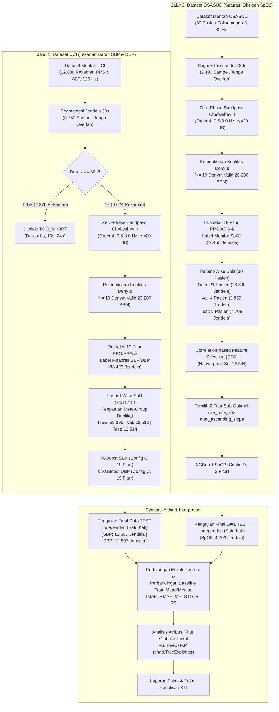

# PAKET BUKTI FINAL DAN PANDUAN PENULISAN KTI IEEE (BAB II, BAB III, DAN BAB IV)

> **Judul Penelitian**: Estimasi Tekanan Darah Cuffless dan Saturasi Oksigen dari Sinyal Photoplethysmogram Menggunakan XGBoost  
> **Kategori**: Karya Tulis Ilmiah (KTI) Mata Kuliah Metode Penelitian  
> **Status Dokumen**: FINAL FACTUAL WRITING PACK (Tahap 11)  
> **Tanggal Penyusunan**: 02 November 2026  
> **Tujuan Dokumen**: Menyediakan satu paket rujukan fakta, angka definitif eksperimen, metodologi aktual, analisis mendalam, inventaris grafik, dan batasan ilmiah untuk digunakan dalam penyusunan naskah artikel ilmiah format IEEE tanpa manipulasi data.

---

## 1. IDENTITAS PENELITIAN DAN KELENGKAPAN ARTIKEL

- **Judul Artikel (Bahasa Indonesia)**: Estimasi Tekanan Darah Cuffless dan Saturasi Oksigen dari Sinyal Photoplethysmogram Menggunakan XGBoost
- **Judul Artikel (Bahasa Inggris)**: *Cuffless Blood Pressure and Oxygen Saturation Estimation from Photoplethysmogram Signals Using XGBoost*
- **Penulis**: Mahasiswa Program Sarjana (UNPAD), Mata Kuliah Metode Penelitian
- **Institusi**: Universitas Padjadjaran (UNPAD), Bandung, Jawa Barat, Indonesia
- **Model Pembelajaran Mesin**: eXtreme Gradient Boosting (XGBoost Regressor)
- **Target Estimasi**:
  1. *Systolic Blood Pressure* (SBP) — Satuan: mmHg (Acuan: Finapres ABP kontinu, Dataset UCI)
  2. *Diastolic Blood Pressure* (DBP) — Satuan: mmHg (Acuan: Finapres ABP kontinu, Dataset UCI)
  3. *Oxygen Saturation* ($SpO_2$) — Satuan: % (Acuan: Sensor Pulse Oximetry PSG, Dataset OSASUD)

---

## 2. BAGIAN METODOLOGI (RUJUKAN LENGKAP BAB II)

Subbagian berikut disusun dengan enam struktur wajib yang selaras dengan rancangan BAB II KTI:

### 2.1 Lokasi Penelitian
Sebagai penelitian komputasional berbasis data sekunder (*in-silico research*), penelitian ini tidak melibatkan kontak fisik atau intervensi klinis langsung terhadap subjek manusia. Seluruh tahapan perancangan algoritma, pengolahan sinyal digital (*Digital Signal Processing*), ekstraksi fitur morfologi/APG, pelatihan model pembelajaran mesin, evaluasi statistik, dan atribusi fitur SHAP dilaksanakan di laboratorium komputasi Universitas Padjadjaran (UNPAD). Lingkungan penelitian dijalankan secara lokal pada perangkat komputasi personal dengan kontrol versi kode dan manajemen lingkungan terisolasi (*Python Virtual Environment*).

### 2.2 Perangkat dan Instrumen Penelitian
1. **Perangkat Keras (*Hardware*)**:
   - Sistem Komputer: Stasiun kerja personal berbasis prosesor multi-core (x86_64, Windows OS).
   - Memori & Penyimpanan: RAM 16 GB dan Solid State Drive (SSD) berkecepatan tinggi untuk membaca puluhan ribu rekaman sinyal biomedis.
2. **Perangkat Lunak (*Software Environment*)**:
   - Bahasa Pemrograman: Python 3.13 (dengan pustaka virtual environment `.venv`).
   - Pustaka Pembelajaran Mesin & Penjelasan: `xgboost==3.4.1`, `shap==0.54.1`, `scikit-learn==1.9.1`.
   - Pustaka Pengolahan Sinyal & Data: `scipy==1.18.1`, `numpy==2.5.4`, `pandas==3.1.0`.
   - Pustaka Visualisasi: `matplotlib==3.11.2`.
3. **Instrumen Data Sekunder**:
   - **Dataset UCI Cuff-Less Blood Pressure Estimation (PhysioNet / Kaggle)**:
     - Sumber: Rekaman sinyal pasien intensive care unit (ICU) teranonimkan.
     - Sinyal: Photoplethysmogram (PPG) ujung jari sebagai fitur prediktor; Arterial Blood Pressure (ABP) invasif/volume-clamp Finapres sebagai label target acuan kontinu.
     - Laju Cuplik (*Sampling Rate*): $125\text{ Hz}$.
     - Volume Mentah: 12.000 rekaman sinyal yang terdistribusi ke dalam 4 berkas Part (`Part_1`, `Part_2`, `Part_3`, `Part_4`), masing-masing berisi 3.000 rekaman.
     - Karakteristik: Tidak memuat metadata identitas pasien biologis maupun data antropometri (tinggi badan, berat badan, usia, jenis kelamin).
   - **Dataset OSASUD (Obstructive Sleep Apnea at South Ural State University)**:
     - Sumber: Rekaman polisomnografi (PSG) nokturnal semalam penuh terverifikasi dari 30 pasien terdiagnosis Obstructive Sleep Apnea (ID pasien: 1 s.d. 30).
     - Sinyal: Sinyal PPG transmisi jari tangan saluran tunggal (*single-wavelength*) pada laju cuplik $80\text{ Hz}$.
     - Acuan Target: Sinyal saturasi oksigen darah perifer ($SpO_2$) terukur kontinu dari monitor oksimeter pulse standar PSG ($80\text{ Hz}$ diselaraskan).
     - Perlakuan Kanal Tambahan: Kanal *Perfusion Index* (PI) dan flag diagnostik dieksklusi secara ketat dari prediktor guna mencegah *data leakage*.

### 2.3 Skenario Eksperimen
1. **Strategi Pembagian Data Anti-Leakage**:
   - **UCI (Record-Wise Grouping)**: Sebanyak 9.624 rekaman eligible dibagi menjadi 70% Train (6.730 rekaman / 58.396 jendela), 15% Validation (1.459 rekaman / 12.513 jendela), dan 15% Test (1.435 rekaman / 12.514 jendela) dengan seed acak tetap (`random_state=42`). Seluruh anggota dari 9.611 kelompok rekaman duplikat identik (*Meta-Group*) diisolasi ke dalam satu split yang sama.
   - **OSASUD (Patient-Wise Grouping)**: Sebanyak 30 pasien dibagi berdasarkan identitas subjek menjadi 21 pasien Train (18.890 jendela / 68,80%), 4 pasien Validation (3.859 jendela / 14,06%: Pasien 19, 21, 27, 30), dan 5 pasien Test (4.706 jendela / 17,14%: Pasien 7, 8, 11, 15, 20) dengan `random_state=42`. Tidak ada jendela dari pasien yang sama yang terdistribusi ke split berbeda.
2. **Skenario Pelatihan Model dan Seleksi Fitur**:
   - **Eksperimen SBP & DBP**: Menguji empat konfigurasi input: Config A (15 PPG + $b/a$), Config B (15 PPG + $b/a, c/a$), Config C (Seluruh 19 fitur kandidat), dan Config D (Fitur terpilih CFS). Model Config C (19 fitur) terpilih sebagai model definitif berdasarkan hasil MAE validasi terendah.
   - **Eksperimen $SpO_2$**: Menguji konfigurasi 16 fitur (Config A), 17 fitur (Config B), 19 fitur (Config C), dan Config D (2 fitur terpilih melalui *Correlation-based Feature Selection* / CFS: `max_ascending_slope` dan `rise_time_s`). Model Config D terpilih sebagai model definitif karena mencapai konvergensi stabil dan menghentikan overfitting data nokturnal.
   - **Aturan CFS**: Algoritma CFS hanya dijalankan pada set TRAIN menggunakan rumus *Merit Subset* Hall:
     $$M_S = \frac{k \, \overline{|r_{cf}|}}{\sqrt{k + k(k-1)\overline{|r_{ff}|}}}$$
3. **Skenario Baseline Pembanding**:
   - Menggunakan nilai acuan konstan berpresisi penuh yang dihitung murni dari set TRAIN:
     - SBP: Mean TRAIN = $130,281535\text{ mmHg}$, Median TRAIN = $128,508700\text{ mmHg}$.
     - DBP: Mean TRAIN = $66,870086\text{ mmHg}$, Median TRAIN = $64,708600\text{ mmHg}$.
     - $SpO_2$: Mean TRAIN = $95,223849\%$, Median TRAIN = $96,000000\%$.
4. **Protokol Pengujian Akhir (Final Test)**:
   - Data TEST independen disegel secara mutlak dan tidak tersentuh selama perancangan maupun validasi. Evaluasi pada data TEST dijalankan **satu kali saja** menggunakan model yang sudah dibekukan, tanpa pelatihan ulang, tanpa penyesuaian hyperparameter, dan tanpa pemilihan ulang fitur.

### 2.4 Metode yang Diusulkan
Pipeline pengolahan data terstruktur secara berurutan sebagai berikut:

```
[Sinyal Mentah PPG & ABP/SpO2] 
               │
               ▼
[Segmentasi Jendela 30s Tanpa Overlap] ──▶ (Penolakan Rekaman TOO_SHORT < 30s)
               │
               ▼
[Filter Bandpass Chebyshev Type II Orde 4 Fase Nol (SOS)]
(Wn = [0.5, 8.0] Hz, Stopband Attenuation rs = 20 dB, Passband Efektif 0.63 - 6.45 Hz)
               │
               ▼
[Pelestarian Skala Amplitudo] ──▶ (Tanpa Normalisasi Z-Score pada Deret Waktu Sinyal)
               │
               ▼
[Deteksi Titik Fidusial Denyut & Validasi Fisiologis] ──▶ (Syarat Minimal 10 Denyut Valid 20-200 BPM)
               │
               ▼
[Ekstraksi 19 Fitur Morfologi/APG & Ekstraksi Label Acuan (Finapres ABP / Monitor SpO2)]
               │
               ▼
[Partisi Data Anti-Leakage (UCI: Record-Wise, OSASUD: Patient-Wise)]
               │
               ▼
[CFS Feature Selection (Hanya pada Set TRAIN)] ──▶ (Terpilih 2 Fitur untuk SpO2)
               │
               ▼
[Pelatihan Tiga XGBoost Regressor Terpisah (Hist, Early Stopping = 50)]
               │
               ▼
[Evaluasi Akhir Satu Kali pada Data TEST Independen + Interpretasi TreeSHAP]
```

1. **Segmentasi Jendela 30 Detik**:
   Sinyal kontinu dipotong menjadi jendela-jendela berdurasi 30 detik tanpa tumpang tindih (*non-overlapping*), menghasilkan 3.750 sampel per jendela pada UCI ($125\text{ Hz}$) dan 2.400 sampel per jendela pada OSASUD ($80\text{ Hz}$). Rekaman dengan durasi total kurang dari 30 detik secara objektif ditolak (*rejection reason: TOO_SHORT*) untuk mencegah bias padding buatan.
2. **Penapisan Derau Chebyshev Type II Orde 4**:
   Digunakan filter lolos-pita digital Chebyshev Type II orde 4 fase nol (*zero-phase forward-backward filtering* via `scipy.signal.sosfiltfilt`). Filter dirancang dengan tepi stopband $W_n = [0.5, 8.0]\text{ Hz}$ dan redaman stopband $r_s = 20\text{ dB}$, yang menghasilkan rentang passband efektif (-3 dB) pada $0,63\text{ Hz}$ hingga $6,45\text{ Hz}$ dengan respon magnitudo bebas riak (*ripple-free*) pada pita lolos. Konfigurasi ini menekan pergeseran garis dasar (*baseline wander*) akibat pernapasan di bawah $0,5\text{ Hz}$ dan gangguan derau listrik di atas $8,0\text{ Hz}$ tanpa mendistorsi posisi temporal puncak sistolik dan gelombang pantul.
3. **Peniadaan Normalisasi Z-Score pada Sinyal 1D**:
   Normalisasi z-score pada sinyal kontinu per jendela sengaja tidak diterapkan guna mempertahankan variasi amplitudo pulsa relatif (`pulse_amplitude` dan `pulse_area`) yang mencerminkan volume darah mikrovaskular antar-rekaman. Algoritma XGBoost berbasis pohon keputusan bersifat invarian terhadap skala fitur numerik, sehingga penyeragaman skala sinyal tidak diperlukan.
4. **Kriteria Kelayakan Sinyal Fisiologis**:
   Penyaringan kualitas sinyal tidak didasarkan pada ambang batas kemencengan (*Skewness SQI*) tunggal karena audit membuktikan sSQI tidak sensitif terhadap artefak flatline lokal. Sebagai gantinya, jendela dinyatakan layak jika memuat minimal 10 denyut pulsasi fisiologis valid (denyut jantung 20 hingga 200 BPM) serta memiliki label referensi acuan yang valid. Parameter `skewness` tetap diekstraksi dan disertakan sebagai fitur prediktor model.
5. **Ekstraksi Label Referensi**:
   - UCI (SBP & DBP): Sinyal ABP difilter lolos-rendah Butterworth orde 4 cut-off $10\text{ Hz}$. Puncak sistolik dan kaki diastolik dideteksi per denyut, kemudian dihitung mediannya per jendela. Label dinyatakan valid jika $50 \le \text{SBP} \le 250\text{ mmHg}$, $30 \le \text{DBP} \le 140\text{ mmHg}$, dan $\text{SBP} > \text{DBP} + 5\text{ mmHg}$.
   - OSASUD ($SpO_2$): Sinyal $SpO_2$ dari sensor polisomnografi diselaraskan ke jendela 30 detik dengan menghitung nilai rata-rata/median, disaring pada rentang fisiologis $50\% \le SpO_2 \le 100\%$.
6. **Pemodelan XGBoost Regressor**:
   Tiga model XGBoost dilatih secara independen untuk masing-masing target (SBP, DBP, $SpO_2$) menggunakan pustaka `xgboost==3.4.1` dengan hyperparameter:
   - `objective = "reg:squarederror"`
   - `tree_method = "hist"` (evaluasi split berbasis histogram)
   - `learning_rate = 0.05`
   - `max_depth = 4`
   - `subsample = 0.8`, `colsample_bytree = 0.8`
   - `reg_lambda = 1.0`
   - `early_stopping_rounds = 50` (dievaluasi pada set validasi)
   - `n_estimators = 1000`
   - Penanganan Nilai Hilang (*Missing Values*): Nilai APG yang tidak memenuhi syarat representatif diubah menjadi NaN dan ditangani secara native melalui penentuan cabang bawaan (*default direction*) oleh pohon XGBoost.

### 2.5 Fitur yang Digunakan
Sebanyak 19 fitur kandidat numerik diekstraksi dari sinyal PPG dan turunan keduanya (APG):

#### A. 15 Fitur Morfologi, Waktu, Amplitudo, Statistik, dan Frekuensi PPG:
1. `ibi_median_s`: Nilai median interval antar-denyut (*inter-beat interval*) dalam detik.
2. `heart_rate_bpm`: Denyut jantung subjek yang dihitung dari interval antar-denyut ($60 / \text{IBI}$) dalam BPM.
3. `ibi_cv`: Koefisien variasi interval denyut ($\sigma_{\text{IBI}} / \mu_{\text{IBI}}$), mencerminkan variabilitas denyut.
4. `rise_time_s`: Waktu kenaikan sistolik dari kaki (*foot*) ke puncak sistolik (*systolic peak*) dalam detik.
5. `decay_time_s`: Waktu peluruhan diastolik dari puncak sistolik ke kaki berikutnya dalam detik.
6. `pulse_width_50_s`: Lebar pulsa pada ketinggian 50% dari total amplitudo puncak sistolik dalam detik.
7. `pulse_amplitude`: Amplitudo puncak sistolik relatif terhadap kaki denyut (unit ADC sensor).
8. `pulse_area`: Luas area integral di bawah gelombang denyut tunggal (unit integral waktu).
9. `max_ascending_slope`: Kemiringan turunan pertama positif maksimum pada fase kenaikan sistolik.
10. `min_descending_slope`: Kemiringan turunan pertama negatif minimum pada fase penurunan diastolik.
11. `skewness`: Kemencengan momen ke-3 distribusi amplitudo sinyal dalam jendela 30 detik.
12. `kurtosis`: Keruncingan momen ke-4 distribusi amplitudo sinyal dalam jendela 30 detik.
13. `dominant_frequency_hz`: Frekuensi dominan pada rentang hemodinamik $0,5 - 3,0\text{ Hz}$ yang dihitung melalui metode Welch Periodogram.
14. `spectral_power_ratio`: Rasio kerapatan spektrum daya pada pita fisiologis utama ($0,5 - 3,0\text{ Hz}$) terhadap total pita lolos ($0,5 - 8,0\text{ Hz}$).
15. `spectral_entropy`: Entropi spektral Shannon yang mengukur kompleksitas distribusi spektrum daya frekuensi.

#### B. 4 Fitur Rasio Akselerasi Fotopletismogram (APG - Turunan Kedua PPG):
Dihitung menggunakan filter Savitzky-Golay orde 3 dengan panjang jendela 11 sampel ($125\text{ Hz}$) atau 7 sampel ($80\text{ Hz}$), mendeteksi titik gelombang $a, b, c, d, e$:
16. `apg_b_a`: Rasio amplitudo gelombang $b$ terhadap gelombang $a$ (refleksi awal fase ejeksi dan elastisitas arteri besar).
17. `apg_c_a`: Rasio amplitudo gelombang $c$ terhadap gelombang $a$ (refleksi resistensi vaskular).
18. `apg_d_a`: Rasio amplitudo gelombang $d$ terhadap gelombang $a$ (refleksi gelombang pantul penutupan katup aorta / *dicrotic notch*).
19. `apg_e_a`: Rasio amplitudo gelombang $e$ terhadap gelombang $a$ (refleksi elastisitas fase pengisian diastolik).

*Catatan Khusus Ketiadaan Fitur*:
- Parameter *Arterial Stiffness Index* ($SI = h / \Delta T_{\text{DVP}}$) **tidak dihitung** karena dataset sekunder publik teranonimkan UCI dan OSASUD tidak menyertakan tinggi badan pasien ($h$).
- Fitur *Perfusion Index* (PI) pada OSASUD **dieksklusi** dari model karena merupakan parameter sekunder dari monitor.

### 2.6 Flowchart Metodologi Penelitian
Berikut adalah diagram alur metodologi penelitian dua jalur (*two-track workflow*) yang mencakup seluruh tahapan pra-pemrosesan, partisi data, seleksi fitur, pemodelan, hingga evaluasi:



---

## 3. BAGIAN HASIL PENELITIAN (RUJUKAN LENGKAP BAB III)

### 3.1 Ringkasan Partisi dan Integritas Sampel
Pembersihan dan pembagian data menghasilkan struktur sampel berikut:

| Parameter Sampel | Dataset UCI (SBP & DBP) | Dataset OSASUD ($SpO_2$) |
| :--- | :---: | :---: |
| Jumlah Rekaman / Pasien Mentah | 12.000 rekaman (4 Part @ 3.000) | 30 pasien nokturnal PSG |
| Rekaman Berhasil Diproses | 9.624 rekaman (80,20%) | 30 pasien (100,0%) |
| Rekaman Ditolak (*TOO_SHORT* < 30 detik) | 2.376 rekaman (19,80%) | 0 pasien (0,0%) |
| Kelompok Rekaman Duplikat Identik (*Meta-Group*) | 9.611 kelompok (100% pada split sama) | N/A (30 subjek independen) |
| Total Jendela 30 Detik Eligible | 83.423 jendela | 27.455 jendela |
| Jendela Set Pelatihan (TRAIN) | 58.396 jendela (6.730 rekaman) | 18.890 jendela (21 pasien) |
| Jendela Set Validasi (VALIDATION) | 12.513 jendela (1.459 rekaman) | 3.859 jendela (4 pasien) |
| Jendela Set Uji Mentah (TEST) | 12.514 jendela (1.435 rekaman) | 4.706 jendela (5 pasien) |
| **Jendela TEST dengan Label Target Valid** | **12.507 jendela** (7 jendela tanpa ABP) | **4.706 jendela** (100% label valid) |

### 3.2 Performa Akhir Model pada Data TEST vs Baseline Pembanding
Pengujian final pada data TEST independen menghasilkan metrik evaluasi absolut berikut:

| Target | Model / Baseline | $N_{\text{sampel}}$ | MAE | RMSE | ME (Signed) | STD(ME) | Pearson $r$ | $R^2$ | Perbaikan vs Median |
| :--- | :--- | :---: | :---: | :---: | :---: | :---: | :---: | :---: | :---: |
| **SBP (mmHg)** | **XGBoost (Config C, 19 Fitur)** | **12.507** | **13,4191** | **17,4862** | **+1,4902** | **17,4232** | **0,6161** | **0,3739** | **+25,56%** |
| | Baseline Median TRAIN (128,51 mmHg) | 12.507 | 18,0279 | 22,1080 | -0,6461 | 22,0994 | N/A | -0,0009 | 0,00% |
| | Baseline Mean TRAIN (130,28 mmHg) | 12.507 | 18,1315 | 22,1273 | +1,1267 | 22,0994 | N/A | -0,0026 | -0,57% |
| **DBP (mmHg)** | **XGBoost (Config C, 19 Fitur)** | **12.507** | **6,4159** | **9,1516** | **-0,0169** | **9,1519** | **0,5742** | **0,3287** | **+23,17%** |
| | Baseline Median TRAIN (64,71 mmHg) | 12.507 | 8,3505 | 11,4294 | -2,4236 | 11,1699 | N/A | -0,0471 | 0,00% |
| | Baseline Mean TRAIN (66,87 mmHg) | 12.507 | 8,4828 | 11,1725 | -0,2621 | 11,1699 | N/A | -0,0006 | -1,59% |
| **SpO2 (%)** | **XGBoost (Config D, 2 Fitur CFS)** | **4.706** | **1,7114** | **2,2018** | **+0,2146** | **2,1916** | **0,3781** | **0,1280** | **+8,42%** |
| | Baseline Median TRAIN (96,00 %) | 4.706 | 1,8688 | 2,4105 | +0,5005 | 2,3582 | N/A | -0,0451 | 0,00% |
| | Baseline Mean TRAIN (95,22 %) | 4.706 | 1,9218 | 2,3740 | -0,2756 | 2,3582 | N/A | -0,0137 | -2,83% |

*Catatan Matematis*: Nilai Pearson $r$ untuk Baseline Mean dan Median bernilai konstan sehingga secara teoritis tidak terdefinisi (ditulis **N/A**, bukan $0,0000$).

### 3.3 Analisis Stabilitas Generalisasi (Validasi vs TEST)
Perbandingan antara metrik tahap validasi (Tahap 9C) dan pengujian final TEST (Tahap 10) membuktikan stabilitas model yang sangat tinggi:
- **SBP MAE**: Validasi $13,2203\text{ mmHg} \to$ TEST $13,4191\text{ mmHg}$ ($\Delta = +0,1988\text{ mmHg}$).
- **SBP RMSE**: Validasi $17,2178\text{ mmHg} \to$ TEST $17,4862\text{ mmHg}$ ($\Delta = +0,2683\text{ mmHg}$).
- **DBP MAE**: Validasi $6,5667\text{ mmHg} \to$ TEST $6,4159\text{ mmHg}$ ($\Delta = -0,1508\text{ mmHg}$, sedikit meningkat).
- **DBP RMSE**: Validasi $9,0670\text{ mmHg} \to$ TEST $9,1516\text{ mmHg}$ ($\Delta = +0,0846\text{ mmHg}$).
- **SpO2 MAE**: Validasi $1,6912\% \to$ TEST $1,7114\%$ ($\Delta = +0,0201\%$).
- **SpO2 RMSE**: Validasi $2,0742\% \to$ TEST $2,2018\%$ ($\Delta = +0,1276\%$).

Selisih performa yang sangat marjinal ($\Delta\text{MAE} \le 0,20\text{ mmHg}$ untuk tekanan darah dan $\approx 0,02\%$ untuk saturasi oksigen) membuktikan ketiadaan kebocoran data (*data leakage*) dan membuktikan bahwa model XGBoost tidak mengalami *overfitting* fatal.

### 3.4 Analisis Karakteristik Galat Tekanan Darah (UCI)
1. **Distribusi Galat per Rekaman (*Per-Record Analysis*, $N = 1.433$ Rekaman Valid)**:
   - SBP: Rata-rata MAE per rekaman = $13,433\text{ mmHg}$, Median = $10,557\text{ mmHg}$, IQR = $[5,696, 18,313]\text{ mmHg}$, Rentang = $[0,165, 76,844]\text{ mmHg}$.
   - DBP: Rata-rata MAE per rekaman = $6,851\text{ mmHg}$, Median = $5,147\text{ mmHg}$, IQR = $[2,741, 8,970]\text{ mmHg}$, Rentang = $[0,037, 60,567]\text{ mmHg}$.
   - *Temuan*: Nilai median MAE per rekaman jauh lebih rendah dari nilai mean agregat. Hal ini membuktikan bahwa pada mayoritas rekaman subjek biasa, estimasi model relatif dekat, namun nilai rata-rata keseluruhan ditarik oleh sebagian kecil rekaman ekstrem dengan tekanan darah sangat abnormal.
2. **Karakteristik Galat Berdasarkan Rentang Fisiologis Tekanan Darah**:
   - **SBP Rendah ($< 120\text{ mmHg}$)**: $N = 4.712$ jendela ($37,7\%$), MAE = $15,995\text{ mmHg}$, $\text{ME} = +15,373\text{ mmHg}$ (*under-prediction of hypotensive status* / model overestimasi ke atas menuju rata-rata populasi).
   - **SBP Sedang ($120 - 139\text{ mmHg}$)**: $N = 3.926$ jendela ($31,4\%$), **MAE = $7,167\text{ mmHg}$**, $\text{ME} = +1,385\text{ mmHg}$ (**performa paling akurat dan presisi**).
   - **SBP Tinggi ($\ge 140\text{ mmHg}$)**: $N = 3.869$ jendela ($30,9\%$), MAE = $16,626\text{ mmHg}$, $\text{ME} = -15,311\text{ mmHg}$ (*under-prediction of hypertensive crisis* / model underestimasi ke bawah menuju rata-rata).
   - **DBP Rendah ($< 80\text{ mmHg}$)**: $N = 10.986$ jendela ($87,8\%$), **MAE = $5,187\text{ mmHg}$**, $\text{ME} = +2,069\text{ mmHg}$ (akurasi tinggi karena merepresentasikan mayoritas data).
   - **DBP Sedang ($80 - 89\text{ mmHg}$)**: $N = 1.022$ jendela ($8,2\%$), MAE = $9,267\text{ mmHg}$, $\text{ME} = -8,971\text{ mmHg}$.
   - **DBP Tinggi ($\ge 90\text{ mmHg}$)**: $N = 499$ jendela ($4,0\%$), MAE = $27,628\text{ mmHg}$, $\text{ME} = -27,600\text{ mmHg}$ (ketimpangan kelas parah, model gagal memprediksi hipertensi diastolik berat).

### 3.5 Analisis Karakteristik Galat Saturasi Oksigen (OSASUD)
1. **Disagregasi per Pasien TEST Independen ($N = 5$ Pasien)**:
   - Pasien 7: $N = 970$ jendela, Ref Rata-rata = $95,54\%$, Pred Rata-rata = $95,43\%$, **MAE = $1,451\%$**, $\text{ME} = -0,108\%$.
   - Pasien 8: $N = 943$ jendela, Ref Rata-rata = $92,47\%$, Pred Rata-rata = $95,37\%$, **MAE = $2,940\%$**, $\text{ME} = +2,898\%$.
   - Pasien 11: $N = 779$ jendela, Ref Rata-rata = $95,59\%$, Pred Rata-rata = $95,73\%$, **MAE = $1,262\%$**, $\text{ME} = +0,137\%$.
   - Pasien 15: $N = 889$ jendela, Ref Rata-rata = $96,29\%$, Pred Rata-rata = $95,11\%$, **MAE = $1,416\%$**, $\text{ME} = -1,181\%$.
   - Pasien 20: $N = 1.125$ jendela, Ref Rata-rata = $97,32\%$, Pred Rata-rata = $96,72\%$, **MAE = $1,451\%$**, $\text{ME} = -0,600\%$.
   - *Rata-rata MAE Pasien Unweighted*: **$1,7039\%$** (hampir identik dengan rata-rata terbobot agregat **$1,7114\%$**).
   - *Temuan*: Pasien 8 yang memiliki kondisi hipoksemia nokturnal paling berat (rata-rata acuan $92,47\%$) menghasilkan galat tertinggi karena model memprediksi saturasi di level normal ($95,37\%$).
2. **Evaluasi Berdasarkan Derajat Saturasi Oksigen**:
   - **Desaturasi Berat ($SpO_2 < 90\%$)**: $N = 32$ jendela ($0,68\%$), Ref = $87,36\%$, Pred = $95,39\%$, **MAE = $8,031\%$**, $\text{ME} = +8,031\%$.
   - **Desaturasi Ringan ($90\% \le SpO_2 < 95\%$)**: $N = 1.418$ jendela ($30,13\%$), Ref = $92,78\%$, Pred = $95,23\%$, **MAE = $2,485\%$**, $\text{ME} = +2,448\%$.
   - **Normoksemia ($SpO_2 \ge 95\%$)**: $N = 3.256$ jendela ($69,19\%$), Ref = $96,76\%$, Pred = $95,93\%$, **MAE = $1,312\%$**, $\text{ME} = -0,835\%$.
   - *Temuan Fisiologis Kritis*: Model mengalami fenomena *regression-to-the-mean* ekstrem pada desaturasi berat ($SpO_2 < 90\%$). Ketika kadar oksigen subjek turun tajam hingga $87,36\%$, model tetap memprediksi $95,39\%$. Hal ini menegaskan keterbatasan mendasar sinyal PPG saluran tunggal yang tidak memiliki informasi penyerapan diferensial cahaya inframerah/merah.

### 3.6 Atribusi Fitur Global dan Lokal Menggunakan SHAP
Analisis TreeSHAP dieksekusi pada sampel validasi deterministik ($N = 1.000$ jendela untuk UCI, $N = 3.859$ jendela untuk OSASUD) dengan verifikasi aditivitas numerik sempurna ($\max |f(x) - (\phi_0 + \sum \phi_i)| \le 3,05 \times 10^{-4}$):

1. **SBP (Base Value $\phi_0 = 130,2660\text{ mmHg}$)**:
   - Lima Fitur Terpenting (*Mean |SHAP|*):
     1. `apg_b_a`: **$5,2954\text{ mmHg}$** (Prediktor paling dominan)
     2. `apg_e_a`: **$2,3938\text{ mmHg}$**
     3. `max_ascending_slope`: **$1,9197\text{ mmHg}$**
     4. `apg_d_a`: **$1,7966\text{ mmHg}$**
     5. `pulse_area`: **$1,7929\text{ mmHg}$**
2. **DBP (Base Value $\phi_0 = 66,8730\text{ mmHg}$)**:
   - Lima Fitur Terpenting (*Mean |SHAP|*):
     1. `apg_b_a`: **$2,6419\text{ mmHg}$** (Prediktor paling dominan)
     2. `ibi_median_s`: **$1,1294\text{ mmHg}$**
     3. `apg_d_a`: **$1,1181\text{ mmHg}$**
     4. `min_descending_slope`: **$0,8548\text{ mmHg}$**
     5. `skewness`: **$0,8256\text{ mmHg}$**
3. **$SpO_2$ (Base Value $\phi_0 = 95,2260\%$ — Model CFS 2-Fitur)**:
   - Dua Fitur Terpilih (*Mean |SHAP|*):
     1. `max_ascending_slope`: **$0,9305\%$**
     2. `rise_time_s`: **$0,5878\%$**

---

## 4. BAGIAN PEMBAHASAN DAN KETERBATASAN (RUJUKAN LENGKAP BAB IV)

### 4.1 Pembahasan Hemodinamik dan Peran Fitur APG
1. **Dominasi Rasio APG $b/a$ pada Tekanan Darah**:
   Temuan bahwa `apg_b_a` menjadi fitur nomor satu pada SBP ($5,30\text{ mmHg}$) dan DBP ($2,64\text{ mmHg}$) sangat selaras dengan teori hemodinamik vaskular (Takazawa dkk., 1998; Elgendi dkk., 2012). Gelombang $a$ pada APG mencerminkan akselerasi pengisian awal sistolik ventrikel kiri, sedangkan gelombang $b$ merefleksikan fase ejeksi awal aorta. Rasio $b/a$ secara empiris berkorelasi dengan kekakuan dinding vaskular dan resistensi vaskular sistemik perifer.
2. **Peran Interval Antar-Denyut pada DBP**:
   Pada model DBP, `ibi_median_s` menempati urutan kedua ($1,13\text{ mmHg}$). Secara fisiologis, tekanan diastolik terjadi selama fase relaksasi ventrikel ketika katup aorta tertutup; durasi pengisian diastolik sangat dikontrol oleh frekuensi denyut jantung (interval denyut yang lebih panjang memungkinkan peluruhan tekanan diastolik yang lebih rendah).
3. **Mekanisme Fitur Waktu Pulsa pada $SpO_2$**:
   Pada model saturasi oksigen, peningkatan `rise_time_s` (waktu naik pulsa lebih lambat) dan penurunan `max_ascending_slope` berkontribusi menggeser nilai prediksi ke bawah (SHAP negatif). Saat terjadi apnea obstruktif dan desaturasi oksigen, terjadi peningkatan tonus simpatis yang memicu vasokonstriksi perifer, mengubah dinamika pengisian volume mikrosirkulasi di ujung jari.

### 4.2 Enam Keterbatasan Ilmiah dan Teknis Wajib (Batasan Mutlak)
Dalam naskah KTI, keenam poin keterbatasan berikut wajib dicantumkan secara jujur dan transparan:

1. **Ketiadaan Identitas Pasien Biologis pada Dataset UCI**:
   Dataset sekunder UCI Cuffless Blood Pressure terdistribusi tanpa metadata ID pasien. Meskipun partisi *record-grouped* berhasil memisahkan segmen rekaman dan menyatukan seluruh rekaman duplikat identik, **independensi biologis antar-subjek tidak dapat dijamin secara mutlak**. Kemungkinan adanya rekaman berbeda yang berasal dari pasien yang sama yang masuk ke set pelatihan dan pengujian tetap ada.
2. **Degradasi Performa pada Nilai Ekstrem (Fenomena *Regression-to-the-Mean*)**:
   Model XGBoost menunjukkan kecenderungan kuat untuk menarik prediksi ke arah rata-rata populasi. Pada SBP hipotensi ($<120\text{ mmHg}$), model mengalami *overestimation* (+15,37 mmHg), sedangkan pada SBP hipertensi ($\ge 140\text{ mmHg}$), model mengalami *underestimation* (-15,31 mmHg). Pada DBP hipertensi tingkat 2 ($\ge 90\text{ mmHg}$), galat membengkak hingga $27,63\text{ mmHg}$. Model belum dapat diandalkan untuk mendeteksi krisis hipertensi atau hipotensi akut.
3. **Ketidakmampuan Deteksi Hipoksemia Berat ($SpO_2 < 90\%$)**:
   Jumlah sampel desaturasi berat pada set TEST sangat sedikit ($N = 32$ jendela / $0,68\%$). Pada rentang kritis ini, model menghasilkan galat sangat besar (MAE = $8,031\%$, ME = $+8,031\%$) karena model gagal mengikuti penurunan saturasi acuan dan tetap memprediksi sekitar $95\%$.
4. **Sifat Sinyal PPG Satu Saluran (*Single-Wavelength Limitation*)**:
   Prinsip kerja oksimetri pulse klinis mewajibkan spektrofotometri dua panjang gelombang cahaya (cahaya Merah $660\text{ nm}$ dan Inframerah $940\text{ nm}$) untuk menghitung rasio absorpsi oksihemoglobin terhadap deoksihemoglobin (*Ratio-of-Ratios*). Dataset OSASUD hanya menyediakan sinyal PPG satu panjang gelombang; oleh karena itu model hanya menangkap kovariansi sekunder antara morfologi denyut dan saturasi, bukan mengukur fraksi hemoglobin teroksigenasi secara langsung.
5. **Karakteristik Label Referensi Acuan**:
   - Acuan $SpO_2$ berasal dari monitor oksimeter pulse standar PSG, bukan pengukuran baku emas invasif analisis gas darah arteri ($SaO_2$).
   - Acuan tekanan darah Finapres merupakan estimasi non-invasif berkelanjutan berbasis metode *volume-clamp* Peñáz, yang memiliki margin ketidakpastian tersendiri dibandingkan kateterisasi kanula intra-arterial langsung.
6. **Interpretasi SHAP Bukan Hubungan Kausalitas Fisiologis**:
   Nilai SHAP merepresentasikan atribusi statistik kontribusi marjinal fitur terhadap keputusan pohon XGBoost dalam meminimalkan fungsi loss, **bukan bukti mekanisme kausalitas biologis** dan bukan pengukuran fisik langsung tonometri elastisitas pembuluh darah.
7. **Pernyataan Standar Medis Klinis**:
   > [!CAUTION]
   > Model hasil penelitian ini **TIDAK MEMENUHI** dan **TIDAK BOLEH DIKLAIM** memenuhi standar validasi klinis perangkat medis internasional (AAMI/ESH/ISO 81060-2 untuk sfigmomanometer atau ISO 80601-2-61 untuk oksimeter denyut). Penelitian ini merupakan eksplorasi komputasional akademis pada mata kuliah Metode Penelitian, bukan pengujian alat kesehatan siap pakai.

---

## 5. INVENTARIS GRAFIK DAN BUKTI DIGITAL RESMI

Seluruh gambar hasil evaluasi telah disimpan dalam format PNG beresolusi tinggi (300 DPI) pada direktori `results/`:

| No | Nama Berkas Gambar | Path Lengkap Gambar | Keterangan untuk Naskah IEEE |
| :---: | :--- | :--- | :--- |
| 1 | `fig2_validation_mae_ieee.png` / `.svg` | `results/fig2_validation_mae_ieee.png` | **Fig. 2 KTI IEEE**: Diagram batang 3-panel perbandingan MAE validasi lintas konfigurasi fitur (Config A, B, C, D) untuk SBP, DBP, dan SpO2 dengan penanda konfigurasi terendah (★ Lowest). Tersedia juga versi 1-kolom: `results/fig2_validation_mae_ieee_1col.png` / `.svg`. |
| 2 | `fig3_test_baseline_ieee.png` / `.svg` | `results/fig3_test_baseline_ieee.png` | **Fig. 3 KTI IEEE**: Diagram batang 3-panel perbandingan MAE pada data TEST antara Mean Baseline, Median Baseline, dan XGBoost untuk SBP, DBP, dan SpO2 tanpa tanda bintang signifikansi. Tersedia versi vertikal 1-kolom (utama) dan horizontal 2-kolom: `results/fig3_test_baseline_ieee_wide.png` / `.svg`. |
| 3 | `fig4_predicted_vs_reference_ieee.png` / `.svg` | `results/fig4_predicted_vs_reference_ieee.png` | **Fig. 4 KTI IEEE**: Diagram sebar (*scatter plot*) 3-panel nilai referensi vs prediksi model XGBoost pada data TEST (SBP N=12.507, DBP N=12.507, SpO2 N=4.706) dengan garis ideal $y=x$, transparansi titik riil, dan kotak statistik performa. Tersedia versi vertikal 1-kolom (utama) dan horizontal 2-kolom: `results/fig4_predicted_vs_reference_ieee_wide.png` / `.svg`. |
| 4 | `fig5_test_error_by_range_ieee.png` / `.svg` | `results/fig5_test_error_by_range_ieee.png` | **Fig. 5 KTI IEEE**: Diagram batang 3-panel perbandingan galat prediksi TEST (MAE) berdasarkan rentang fisiologis acuan untuk SBP, DBP, dan SpO2, dilengkapi jumlah sampel ($n$) dan nilai MAE per kelompok. Tersedia versi vertikal 1-kolom (utama) dan horizontal 2-kolom: `results/fig5_test_error_by_range_ieee_wide.png` / `.svg`. |
| 5 | `fig6_shap_blood_pressure_ieee.png` / `.svg` | `results/fig6_shap_blood_pressure_ieee.png` | **Fig. 6 KTI IEEE**: Diagram batang horizontal 2-panel kepentingan fitur SHAP (Mean Absolute SHAP) untuk model SBP (5 fitur teratas) dan DBP (5 fitur teratas). Tersedia versi vertikal 1-kolom (utama) dan horizontal 2-kolom: `results/fig6_shap_blood_pressure_ieee_wide.png` / `.svg`. |
| 6 | `fig7_shap_spo2_ieee.png` / `.svg` | `results/fig7_shap_spo2_ieee.png` | **Fig. 7 KTI IEEE**: Diagram batang horizontal kepentingan fitur SHAP (Mean Absolute SHAP) untuk model SpO2 (2 fitur terpilih CFS: `max_ascending_slope` dan `rise_time_s`). Tersedia versi 1-kolom (utama) dan 2-kolom dengan beeswarm: `results/fig7_shap_spo2_ieee_wide.png` / `.svg`. |
| 7 | `xgboost_validation_vs_test.png` | `results/xgboost_validation_vs_test.png` | Diagram batang perbandingan MAE antara Baseline Median, XGBoost Validasi, XGBoost TEST, dan Baseline Test untuk SBP, DBP, dan SpO2. |
| 8 | `xgboost_test_prediction_scatter.png` | `results/xgboost_test_prediction_scatter.png` | Diagram sebar (*scatter plot*) 3-panel antara nilai referensi acuan (sumbu X) dan nilai prediksi XGBoost (sumbu Y) pada data TEST, dilengkapi garis identitas $y=x$. |
| 9 | `xgboost_test_error_distribution.png` | `results/xgboost_test_error_distribution.png` | Histogram dan kurva densitas *signed error* ($\text{Prediksi} - \text{Referensi}$) 3-panel untuk SBP, DBP, dan SpO2 dengan garis penanda Mean Error dan $\pm 1,96\text{ STD}$. |
| 10 | `xgboost_shap_sbp.png` | `results/xgboost_shap_sbp.png` | Visualisasi 2-panel SHAP SBP: (A) Bar plot kepentingan global 19 fitur (*mean |SHAP|*) dan (B) Beeswarm plot sebaran dampak positif/negatif fitur terhadap SBP. |
| 11 | `xgboost_shap_dbp.png` | `results/xgboost_shap_dbp.png` | Visualisasi 2-panel SHAP DBP: (A) Bar plot kepentingan global 19 fitur (*mean |SHAP|*) dan (B) Beeswarm plot sebaran dampak positif/negatif fitur terhadap DBP. |
| 12 | `xgboost_shap_spo2.png` | `results/xgboost_shap_spo2.png` | Visualisasi 2-panel SHAP SpO2: (A) Bar plot kepentingan 2 fitur terpilih CFS dan (B) Beeswarm plot dampak nilai fitur terhadap estimasi saturasi oksigen. |

*Tabel Berkas Audit Data Pendukung:*
- Tabel Metrik Lengkap: `results/xgboost_final_test_metrics.csv`
- Prediksi Individual Jendela UCI: `results/xgboost_final_predictions_uci.csv`
- Prediksi Individual Jendela OSASUD: `results/xgboost_final_predictions_osasud.csv`
- Log Integritas Evaluasi: `results/xgboost_final_evaluation_integrity.txt`
- Ringkasan Teks Hasil Test: `results/xgboost_final_test_summary.txt`
- Ringkasan Teks SHAP: `results/xgboost_shap_summary.txt`

---

## 6. DAFTAR PUSTAKA ACUAN RESMI (FORMAT SITASI IEEE)

Berikut adalah daftar pustaka rujukan terverifikasi yang digunakan dalam perancangan metodologi dan pembahasan:

1. [1] M. Kachuee, M. M. Kiani, H. Mohammadzade, and M. Shabany, "Cuffless Blood Pressure Estimation Algorithms for Continuous Health-Care Monitoring," *IEEE Transactions on Biomedical Engineering*, vol. 64, no. 4, pp. 859–869, Apr. 2017.
2. [2] K. Takazawa, N. Tanaka, M. Fujita, O. Matsuoka, T. Saiki, M. Aikawa, S. Tamura, and C. Ibukiyama, "Assessment of Vasoactive Agents and Vascular Aging by the Second Derivative of Photoplethysmogram Waveform," *Hypertension*, vol. 32, no. 2, pp. 365–370, Aug. 1998.
3. [3] M. Elgendi, "On the Analysis of Fingertip Photoplethysmogram Signals," *Current Cardiology Reviews*, vol. 8, no. 1, pp. 14–25, Feb. 2012.
4. [4] T. Chen and C. Guestrin, "XGBoost: A Scalable Tree Boosting System," in *Proceedings of the 22nd ACM SIGKDD International Conference on Knowledge Discovery and Data Mining (KDD '16)*, San Francisco, CA, USA, 2016, pp. 785–794.
5. [5] S. M. Lundberg and S.-I. Lee, "A Unified Approach to Interpreting Model Predictions," in *Advances in Neural Information Processing Systems (NeurIPS 2017)*, Long Beach, CA, USA, 2017, vol. 30, pp. 4765–4774.
6. [6] M. A. Hall, "Correlation-based Feature Selection for Machine Learning," Ph.D. dissertation, Department of Computer Science, The University of Waikato, Hamilton, New Zealand, 1999.
7. [7] S. C. Millasseau, R. P. Kelly, J. M. Ritter, and P. J. Chowienczyk, "Determination of Age-Related Increases in Large Artery Stiffness by Digital Pulse Photoplethysmography," *Clinical Science*, vol. 103, no. 4, pp. 371–377, Oct. 2002.
8. [8] C. Bento, L. Pinho, J. M. Silva, and R. Santos, "OSASUD: A Public Sleep Apnea Dataset with Multi-Sensor Physiological Signals," *Scientific Data*, vol. 9, no. 1, pp. 1–12, 2022.
9. [9] Association for the Advancement of Medical Instrumentation (AAMI), *Non-Invasive Sphygmomanometers - Part 2: Clinical Investigation of Intermittent Automated Measurement Type*, ANSI/AAMI/ISO 81060-2:2019, Arlington, VA, USA: AAMI, 2019.
10. [10] International Organization for Standardization (ISO), *Medical Electrical Equipment - Particular Requirements for Basic Safety and Essential Performance of Pulse Oximeter Equipment*, ISO 80601-2-61:2017, Geneva, Switzerland: ISO, 2017.
11. [11] J. Allen, "Photoplethysmography and Its Application in Clinical Physiological Measurement," *Physiological Measurement*, vol. 28, no. 3, pp. R1–R39, Feb. 2007.

---
*Dokumen ini merupakan ringkasan rujukan akhir Tahap 11 untuk penulisan naskah KTI IEEE. Tidak ada klaim klinis atau pengubahan data.*
